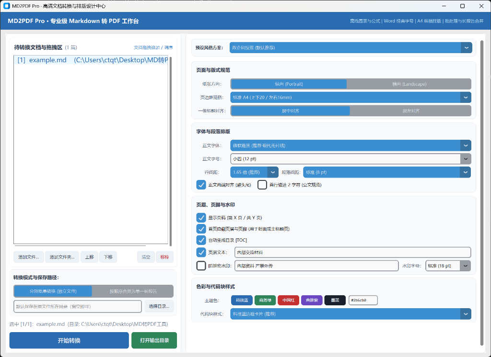
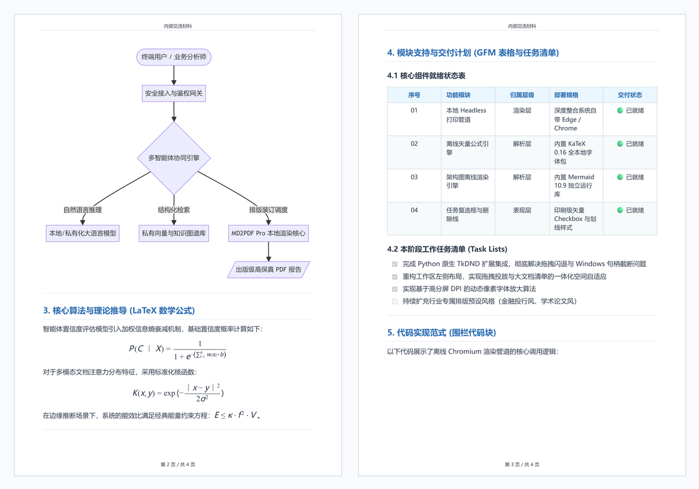

# MD2PDF Pro · Professional Markdown to PDF Publishing Workbench

<p align="center">
  <strong>The Open-Source Publishing Workbench for AI Deliverables · Transform LLM Markdown into Executive-Ready, Publication-Grade PDFs in One Click</strong>
</p>

<p align="center">
  <a href="README.md"><b>简体中文</b></a> | <a href="README_EN.md"><b>English</b></a>
</p>

<p align="center">
  
  
  
  
  
  
  
</p>

<p align="center">
  <a href="https://github.com/BeaverMakerLab/MD2PDF-Pro/releases/latest">
    
  </a>
</p>

<p align="center">
  
</p>

---

## 💡 Why MD2PDF Pro?

With the widespread adoption of large language models like **ChatGPT, Claude, DeepSeek, and Kimi**, **Markdown** has become the de facto output format for AI content. However, when delivering these outputs to clients, executives, or non-technical colleagues, a universal dilemma emerges:

> **"Markdown is designed for machines and developers, but beautifully formatted PDFs are what executives, clients, and partners actually want to read."**

- ❌ **Sending raw `.md` files**: Non-technical recipients lack dedicated Markdown viewers. Looking at unrendered `#`, `|---|`, `$$`, and raw code spans feels cluttered and unpolished.
- ❌ **Copy-pasting into Microsoft Word**: Formatting falls apart immediately. Tables break, LaTeX math equations turn into plaintext gibberish, and Mermaid diagrams are lost completely.
- ❌ **Using cloud online converters**: Proprietary business strategies, prompt pipelines, and research data involve sensitive trade secrets. Uploading them to random public cloud servers introduces unacceptable privacy risks.
- ❌ **Using heavyweight CLI toolchains (e.g., Pandoc / LaTeX)**: Prohibitive setup hurdles, requiring gigabytes of compilation toolchains that cannot be easily deployed on standard corporate workstations.

**MD2PDF Pro** solves this last-mile delivery challenge: **100% offline, zero cloud dependencies, zero external compilers, and single-click publication-grade PDF reports.**

---

## 📊 Live Showcase Comparison (Markdown vs PDF)

This repository includes a comprehensive demo document [`example.md`](example.md). Under the default "Tech Blue" theme, the resulting publication-grade output [`example.pdf`](example.pdf) renders as follows:

<p align="center">
  
  <br>
  <em>Left: Offline vector Mermaid architecture diagrams & LaTeX math formulas; Right: GFM professional tables, task list checkboxes & code cards.</em>
</p>

### Rendering Comparison Matrix

| Syntax / Feature | Raw LLM Output ([`example.md`](example.md)) | MD2PDF Pro Output ([`example.pdf`](example.pdf)) |
| :--- | :--- | :--- |
| **Architecture Diagrams** | ```` ```mermaid graph TD ... ``` ```` | **Offline Vector Diagrams**: Crisp layout automatically scaled to page width without raster distortion |
| **Math Equations** | `$$P(C \mid X) = \frac{1}{1 + e^{-(\dots)}}$$` | **Vector-grade KaTeX Typography**: High-precision fractions, roots, and Greek symbols suitable for printing |
| **Data Tables** | `\| ID \| Module \| Status \|`<br>`\| :---: \| :--- \| :---: \|` | **Enterprise Tech-Blue Tables**: Soft blue headers, subtle gray borders, zebra striping & word-wrap protection |
| **Task Lists** | `- [x] Completed task`<br>`- [ ] In progress` | **Print-Ready Checkboxes**: Rendered as crisp read-only checkboxes with theme accent highlights |
| **Fenced Code Blocks** | ```` ```python def render(): ... ``` ```` | **Card Code Containers**: Consolas monospace font, left accent border, and subtle light-gray cards |
| **Strikethrough** | `~~Original budget: $120,000~~` | **Subtle Strike Line**: Clean horizontal strikethrough with soft muted gray text |
| **Footnotes** | `[^1]` and `[^1]: Whitepaper details` | **Superscript Anchors**: Automatic bottom separator and detailed footnote section at the document end |

---

## ✨ Key Highlights

### 1. 🛡️ 100% Local, Offline & Privacy-First
- **Data Never Leaves Your Machine**: Leverages your local pre-installed Chromium pipeline (automatically discovers Windows Microsoft Edge or Google Chrome) for silent headless printing. **Zero network telemetry, zero cloud uploads**, fully compliant with strict corporate and government security audits.

### 2. 🎨 Finely Tuned Publication Aesthetics
- **Three Curated Themes**:
  - **Tech Blue (Default & Recommended)**: Designed for digital transformation whitepapers, technical proposals, and executive briefings.
  - **Government / Formal Style**: Traditional red-black color scheme with standard 2-character Chinese paragraph indentation.
  - **GitHub Clean**: Classic minimalist developer aesthetic with crisp gray lines.
- **Word-Style Typographic Controls**: Standard typographic font sizing (e.g., 12pt, 14pt, 16pt), eliminating confusing unitless sliders.
- **Layout & Widow Prevention**: Instant Portrait / Landscape switching, customizable margins, and H1 heading alignment with `page-break-after: avoid` to prevent orphan headings at page bottoms.

### 3. 📐 100% CommonMark & GFM Support
- **Robust Table Rendering**: Auto column balancing, word-wrap wrapping, and zebra striping.
- **Offline LaTeX Math (Built-in KaTeX 0.16)**: Inline `$E=mc^2$` and display math `$$\int f(x)dx$$` rendered natively as vector graphics.
- **Offline Mermaid Diagrams (Built-in Mermaid 10.9)**: Directly write flowcharts, sequence diagrams, class diagrams, state diagrams, and Gantt charts without internet access.
- **Rich Extensions**: Task list checkboxes (`- [ ]` / `- [x]`), strikethrough (`~~text~~`), table of contents (`[TOC]`), footnotes (`[^1]`), and native raw HTML tags.

### 4. 📑 Batch Processing & Multi-Chapter Merging
- **Batch Independent Conversion**: Drop in dozens of Markdown files or entire directories to export separate individual PDFs simultaneously.
- **Ordered Merge into a Single Book**: Reorder chapters with simple Up/Down controls to bind multiple standalone files into a unified long report.

### 5. 🔒 Enterprise-Grade Formal Elements
- **Anti-Leak Diagonal Watermarks**: Customizable text with scalable font sizes (14pt to 40pt) and dynamic SVG tile rotation to prevent edge clipping.
- **Formal Headers, Footers & Pagination**: Dynamic `Page X of Y` page numbering with smart cover page suppression.

### 6. 🖥️ Modern Windows High-DPI Adaptation
- **Native TkDND Drag-and-Drop**: Built on native Windows OLE drag-and-drop protocols. Drag single files, multiple files, or whole folders with zero crash risk.
- **High-DPI Font Compensation**: Dynamic pixel scaling for 2.5K / 4K monitors (150% ~ 200% scaling), ensuring crisp, easily readable UI fonts.

---

## 🚀 Quick Start

### Option 1: Download Portable Windows Binary (No Python Required · Recommended)

1. Go to [GitHub Releases](https://github.com/BeaverMakerLab/MD2PDF-Pro/releases/latest) and download **`MD2PDF-Pro-v1.0.0-windows-x64.zip`**;
2. Extract the `.zip` archive to any local folder;
3. Double-click **`MD2PDF-Pro.exe`** to launch the workbench immediately!

---

### Option 2: Clone & Launch via Batch File

1. Clone this repository locally:
   ```bash
   git clone https://github.com/BeaverMakerLab/MD2PDF-Pro.git
   ```
2. Double-click **`【启动 MD2PDF Pro】.bat`** in the project root directory.

---

### Option 3: Run from Source

Make sure Python 3.10+ is installed:

```bash
# 1. Navigate to the project directory
cd MD2PDF-Pro

# 2. Install minimal dependencies
pip install -r requirements.txt

# 3. Launch the application
python md2pdf_pro.py
```

---

## 🛠️ Markdown Syntax Support Matrix

| Category | Syntax Elements | Rendered Output |
| :--- | :--- | :--- |
| **CommonMark** | Headings (`#` ~ `######`) | Clean margins, widow-heading prevention, center/left alignment |
| **CommonMark** | Bold (`**`), Italic (`*`), Quotes (`>`) | Left accent border, soft gray background cards |
| **CommonMark** | Lists, Hyperlinks, Images | Automatic indentations, local relative & absolute image paths auto-resolved |
| **GFM Extension** | Tables (`\| col1 \| col2 \|`) | Soft blue header background, alternating rows, alignment (`:---`, `:---:`) |
| **GFM Extension** | Fenced Code Blocks (```` ```python ````) | Monospace Consolas, rounded border cards, comfortable line spacing |
| **GFM Extension** | Task Lists (`- [ ]`, `- [x]`) | Print-quality vector checkboxes highlighting task status |
| **GFM Extension** | Strikethrough (`~~deleted~~`) | Subtle horizontal strikethrough with muted text |
| **GFM Extension** | Footnotes (`[^1]`) | Superscript cross-reference anchors with document-bottom annotations |
| **GFM Extension** | Table of Contents (`[TOC]`) | Scans document headings to generate structured navigation trees |
| **Advanced Math** | LaTeX Math Equations (`$...$`, `$$...$$`) | Built-in offline KaTeX engine rendering vector mathematical formulas |
| **Advanced Diagrams**| Mermaid Diagrams (```` ```mermaid ````) | Built-in offline Mermaid engine rendering vector flowcharts & sequence charts |
| **HTML Mixing** | Raw HTML tags | Embed `<div>`, `<span style="...">`, `<center>`, `<kbd>` directly in Markdown |

---

## 📂 Project Structure

```text
md2pdf-pro/
├── assets/
│   ├── js/
│   │   ├── auto-render.min.js   # Offline KaTeX auto-render engine
│   │   ├── katex.min.css        # Offline KaTeX stylesheet & fonts
│   │   ├── katex.min.js         # Offline KaTeX core engine
│   │   └── mermaid.min.js       # Offline Mermaid vector diagram engine
│   ├── themes/                  # CSS theme presets
│   │   ├── github_clean.css
│   │   ├── gov_academic.css
│   │   └── tech_blue.css
│   ├── ui_preview.png           # UI screenshot
│   └── pdf_preview_showcase.png # Showcase comparison image
├── 【启动 MD2PDF Pro】.bat      # Silent one-click Windows launcher
├── config.json                  # Persistent typography configurations
├── md2pdf_pro.py                # Core application (UI & rendering pipeline)
├── example.md                   # Complete test document
├── example.pdf                  # Rendered output sample
├── requirements.txt             # Minimal Python dependencies
├── .gitignore                   # Git ignore file
├── LICENSE                      # MIT Open Source License
├── README.md                    # Chinese documentation
└── README_EN.md                 # English documentation
```

---

## ❓ FAQ

#### Q1: Do I need to install Node.js, Pandoc, or wkhtmltopdf?
> **No.** MD2PDF Pro does not depend on any heavy external compilers. It uses standard Python libraries and quietly leverages the Headless printing pipeline of Windows built-in Microsoft Edge (or Google Chrome).

#### Q2: Can it run in disconnected, air-gapped intranet environments?
> **Yes.** All rendering engines (KaTeX, Mermaid), UI components, and typography stylesheets are 100% packaged locally inside the `assets/` directory. Unplugging your network cable will not affect any functionality.

#### Q3: Where are exported PDF files saved?
> By default, PDFs are saved in the **same directory as the source Markdown file**. If a custom directory is selected in the left panel, exports are gathered into that folder. Click "Open Output Directory" to navigate there immediately.

---

## 📄 License

This project is licensed under the [MIT License](LICENSE). Feel free to use it for both personal and commercial purposes.
