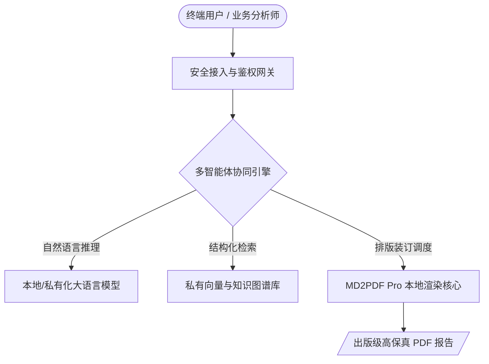

# AI 智能体系统架构与业务技术规范

> **导读**：本文档为标准 Markdown 演示样例，涵盖 CommonMark 基础排版规范与 GFM（GitHub Flavored Markdown）高阶扩展要素，用于测试并检验 MD2PDF Pro 的出版级排版与渲染成效。

[TOC]

---

## 1. 项目概述与核心目标

本平台基于自主可控的大模型与智能体协同底座，旨在为企事业单位提供安全、合规、沉浸式的人机协同分析能力。

系统建设遵循以下三项基本原则：
1. **数据隐私绝对闭环**：关键计算与敏感报告排版全流程离线，杜绝公网泄密；
2. **多端自适应交付**：一键生成适用于高管汇报、专家评审的标准装订出版物；
3. **图表与公式原生保真**：完整保留工程架构图与专业数学推导过程。

---

## 2. 关键架构设计 (Mermaid 矢量图表)

平台由用户交互层、编排调度层、执行计算层三部分组成，整体业务链路如下：



---

## 3. 核心算法与理论推导 (LaTeX 数学公式)

智能体置信度评估模型引入加权信息熵衰减机制，基础置信度概率计算如下：

$$P(C \mid X) = \frac{1}{1 + e^{-\left(\sum_{i=1}^{n} w_i x_i + b\right)}}$$

对于多模态文档注意力分布特征，采用标准化核函数：

$$K(x, y) = \exp\left(-\frac{\|x - y\|^2}{2\sigma^2}\right)$$

在边缘推断场景下，系统的能效比满足经典能量约束方程：$E \le \kappa \cdot f^2 \cdot V$。

---

## 4. 模块支持与交付计划 (GFM 表格与任务清单)

### 4.1 核心组件就绪状态表

| 序号 | 功能模块 | 归属层级 | 部署规格 | 交付状态 |
| :---: | :--- | :---: | :--- | :---: |
| 01 | 本地 Headless 打印管道 | 渲染层 | 深度整合系统自带 Edge / Chrome | 🟢 已就绪 |
| 02 | 离线矢量公式引擎 | 解析层 | 内置 KaTeX 0.16 全本地字体包 | 🟢 已就绪 |
| 03 | 架构图离线渲染引擎 | 解析层 | 内置 Mermaid 10.9 独立运行库 | 🟢 已就绪 |
| 04 | 任务复选框与删除线 | 表现层 | 印刷级矢量 Checkbox 与划线样式 | 🟢 已就绪 |

### 4.2 本阶段工作任务清单 (Task Lists)

- [x] 完成 Python 原生 TkDND 扩展集成，彻底解决拖拽闪退与 Windows 句柄截断问题
- [x] 重构工作区左侧布局，实现拖拽投放与大文档清单的一体化空间自适应
- [x] 实现基于高分屏 DPI 的动态像素字体放大算法
- [ ] 持续扩充行业专属排版预设风格（金融投行风、学术论文风）

---

## 5. 代码实现范式 (围栏代码块)

以下代码展示了离线 Chromium 渲染管道的核心调用逻辑：

```python
import subprocess
import os

def render_to_pdf_headless(html_path: str, output_pdf_path: str) -> None:
    """调用系统自带 Chromium 管道，实现 100% 离线打印输出"""
    chrome_path = r"C:\Program Files (x86)\Microsoft\Edge\Application\msedge.exe"
    cmd = [
        chrome_path,
        "--headless",
        "--disable-gpu",
        "--no-pdf-header-footer",
        f"--print-to-pdf={output_pdf_path}",
        html_path
    ]
    subprocess.run(cmd, check=True)
    print(f"[SUCCESS] 出版级 PDF 已成功生成至: {output_pdf_path}")
```

> **提示**：原技术路线曾规划引入轻量级 WebKit 方案，因兼容性限制已废止（~~原计划预算 ￥120,000~~，现定案为 `￥0` 自主零依赖实现）。详细说明可参见项目技术白皮书[^1]。

[^1]: 技术白皮书存档于内网知识库《AI Agent 交付物工程化指南 v2.4》。
